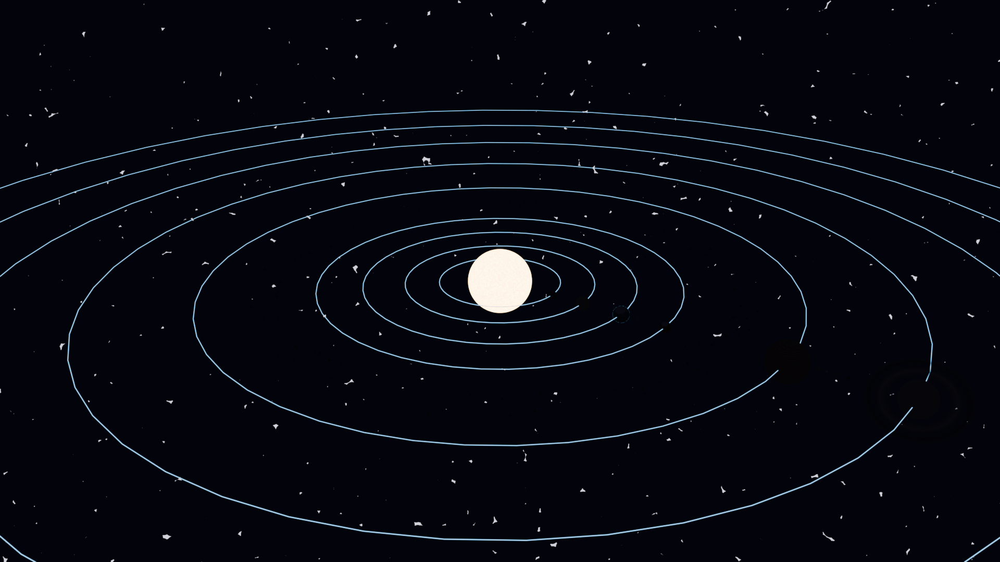
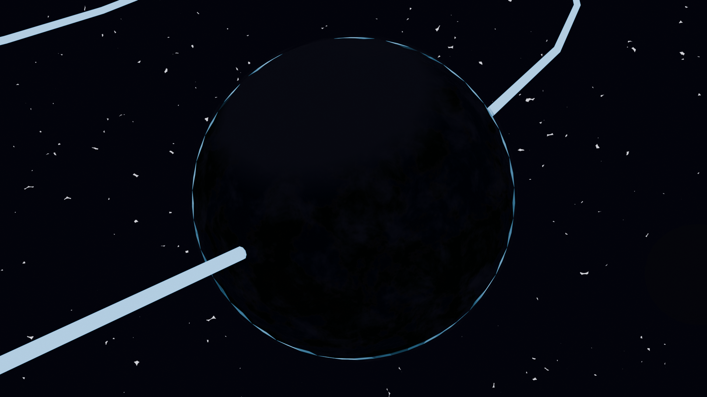
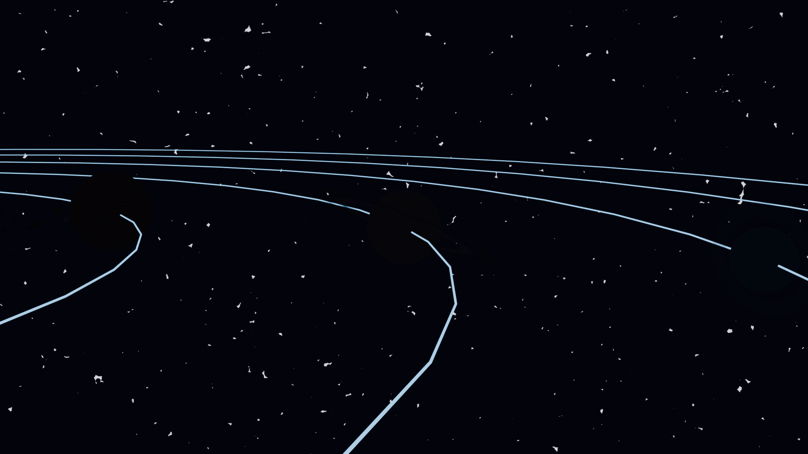

# 🪐 3D Solar System Project in Blender



A fully automated, procedurally shaded, mathematically animated 3D Solar System project built entirely inside **Blender 5.x / 4.x** using Python (`bpy`).

---

## 🌟 Project Highlights

- **Sun & Realistic Lighting:** High-emission fiery plasma granulation shader with central 18,000 W point light source casting realistic planetary shadows.
- **8 Celestial Planets + Pluto:** Accurate astronomical order, proportional scaling, and custom PBR/procedural surface textures.
- **100% Blender Procedural Earth:** Glossy mirror-reflective oceans, continent biomes, white polar ice caps (via `abs(Z)` coordinate symmetry), mountain bump relief, and a separate hovering 3D cloud sphere drifting at `1.018` scale.
- **Saturn & Rings:** High-detail concentric rings featuring the Cassini Division gap modeled via Pythagoras distance math `sqrt(X^2 + Y^2)`.
- **Asteroid Belt:** 130 scattered, tumbling rocky asteroids between Mars and Jupiter.
- **Mathematical Animation Drivers:** Planets continuously revolve around the Sun at Kepler-proportional speeds via `rotation_euler` expressions (`frame * speed`).
- **Deep Space Environment:** Infinite-resolution procedural starfield in the World shader using Voronoi noise.
- **10-Minute Presentation Video Included:** Full 1080p MP4 presentation video with complete audio explanation covering the application and code architecture.

---

## 📸 Close-Up Features

| Procedural Earth & Floating 3D Clouds | Saturn's Concentric Rings & Cassini Division |
| :---: | :---: |
|  |  |

---

## 🪐 Planetary Features & Scale Matrix

| Celestial Object | Geometry | Surface Material | Orbital Distance | Scale / Radius | Speed Factor |
| :--- | :--- | :--- | :--- | :--- | :--- |
| **Sun** | UV Sphere (64x32) | Fiery yellow-orange emission (`Strength: 14.0`) | Center `(0, 0, 0)` | Radius: `4.2` | `0.005` |
| **Mercury** | UV Sphere | Rocky cratered slate-grey/brown surface | Distance: `8.0` | Radius: `0.55` | `0.040` |
| **Venus** | UV Sphere | Dense golden-cream cloud haze (retrograde rotation) | Distance: `12.5` | Radius: `0.92` | `0.026` |
| **Earth** | UV Sphere (Dual layer) | Glossy oceans, continents, polar ice caps + 3D clouds | Distance: `18.0` | Radius: `1.05` | `0.018` |
| **Moon** | UV Sphere | Cratered lunar grey satellite orbiting Earth | Distance: `2.2` (from Earth) | Radius: `0.28` | `0.090` |
| **Mars** | UV Sphere | Rusty iron oxide surface + white polar ice caps | Distance: `24.0` | Radius: `0.68` | `0.013` |
| **Asteroids** | 130 Icospheres | Tumbling dark rocky fragments | Distance: `27.5 - 33.5` | Random | `0.0095` |
| **Jupiter** | UV Sphere | Banded atmospheric stripes + 4 Galilean moons | Distance: `39.0` | Radius: `2.50` | `0.0075` |
| **Saturn** | UV Sphere + Ring Disc | Golden-tan giant + multi-band rings with Cassini gap | Distance: `53.0` | Radius: `2.05` | `0.0050` |
| **Uranus** | UV Sphere + Ring | Pale ice-cyan atmosphere with 97.8° axial tilt | Distance: `67.0` | Radius: `1.45` | `0.0033` |
| **Neptune** | UV Sphere | Deep sapphire blue atmosphere with storm wisps | Distance: `80.0` | Radius: `1.40` | `0.0022` |

---

## 🚀 How to Open and Run in Blender

1. Open **`solar_system.blend`** in Blender.
2. Press **`Spacebar`** to start continuous real-time orbital revolutions.
3. Press **`0`** (Numpad 0) to view through the cinematic tracking camera.
4. Click the **`Scripting`** tab in the top header to view or modify `solar_system_generator.py` in Blender's built-in Text Editor.

To regenerate the entire scene from scratch using the terminal:
```bash
blender -b --python create_solar_system.py
```

---

## 🎥 10-Minute Video Presentation

The full 11-minute presentation video is included in this repository:
- **File:** `Emergent_AI_Package/Solar_System_10Min_Presentation.mp4`
- **Part 1 (0:00 - 5:14):** 3D Application & Planetary Systems Walkthrough.
- **Part 2 (5:14 - 11:08):** Python Architecture, Procedural Shaders, and Driver Math Walkthrough.
